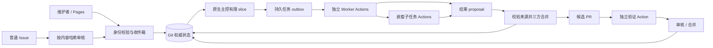

# Argus GitHub 宿主

这是 `microsoft/ArgusAgent` 的完整 fork，新增 GitHub 部署宿主。保留原生 Manager、Planner、Engineer、Reviewer、研究工作流、技能和记忆机制；宿主负责授权、调度、持久化与交付。它不是把主控和所有子 agent 装进同一个 Action。

**当前状态：可验证的工程实现，真实模型长期质量仍待验收。** Device Flow 暂缓。没有模型凭据时可以部署 Pages、初始化暂停项目、执行确定性的分布式验收，不能证明研究能力或模型性能与常驻运行相同。

## 工作方式



主控可以不断自主规划、复盘、改道，决定后续工作或完成；每次执行到有限边界保存状态并退出。程序根据持久 continuation、任务结果、维护者操作和仓库变化唤醒它。没有变化且没有自主 continuation 时不调用模型。15 分钟定时器只是补偿漏掉的通知，不能保证精确调度时间。

“贯穿生命周期”的是项目身份、目标版本、原生记忆和恢复记录。它不是永远不结束的操作系统进程，也不能承诺模型厂商的同一个会话永不失效。宿主不额外摘要或压缩记忆；原生 Argus 和模型 provider 自己的上下文策略仍然存在。

## Fork 后部署

1. Fork 本仓库，默认分支使用 `github-host`。在 Actions 页面启用该 fork 的 workflows。
2. 在 Settings → Actions → General 允许工作流创建 PR；组织策略若禁止该能力，需要管理员调整。工作流内已经声明各 job 所需权限。
3. 在 Settings → Pages 将 Source 设为 **GitHub Actions**，运行 `Argus Pages`。不需要服务器。
4. 在 Settings → Secrets and variables → Actions 添加 `OPENAI_API_KEY`。当前默认安装并固定 Codex CLI，配置为 `backend: codex`。可选仓库变量 `OPENAI_BASE_URL`。模型凭据只交给执行 job；不要放到 Issue、输入 JSON、Git 文件或网页 PAT 字段。
5. 检查 `.argus-host/config.json` 的模型、并行度、预算和验证命令。默认 `global_daily_cap_usd: 0` 表示不设预算上限，建议在启动前设置符合自己的金额及 token 限额。
6. 打开 Pages，输入 `owner/repository`。公开项目可匿名读取。要操作，创建**仅授权该仓库**的 fine-grained PAT：Contents 读取、Actions 读写；上传附件另需 Contents 写入，私有 Issue 审核需 Issues 读取。维护者身份与 API 的具体操作权限是两项检查。PAT 仅存在当前页内存，刷新后需重新输入；不是模型 API key。
7. 填写长期目标、边界及验收条件，选择“建立项目，暂不运行”或“初始化并启动”。后者会开始产生模型调用。

当前部署不支持直接从纯静态 Pages 完成 Device Flow。不要把客户端 secret 或 PAT 打包进静态页面来绕过这个边界。

其他 provider 的原生代码仍保留，但当前 Actions 默认只安装 Codex。要启用其他 provider，需修改固定版本的 `.github/actions/argus-host-setup/action.yml`，声明对应 Secrets，并完成同样的验收。未安装的 backend 会明确失败，不应静默切换到测试 backend。

## 日常操作

原生工作台保留项目、任务、研究、地图、技能、知识、产物等视图。数据从 Git 中的投影读取；尚未生成的查询和写操作转为独立 API Worker。原生 HTTP handler 在有限 job 内执行，不部署常驻 WebAPI。

Pages 部署后单独运行 `Argus Pages projections`，在无模型 key、无写 Token 的 job 中刷新投影，再由可信发布 job 保存；不用为 UI 的读取格式更新升级 agent runtime。状态在投影期间变化时丢弃旧投影，可重新运行。静态公开读取走公开 Git 文件，避免持续消耗匿名 REST 配额。

- 页面“暂停”停止新工作派发，当前已运行 slice 可完成并保存结果。“恢复”继续同一个项目身份。
- 在原生工作台提交请求，由原生 Manager 评估与路由。需求不直接覆盖长期目标。
- 普通 Issue 先由程序保存。Pages 的“仓库长期目标与待审核请求”显示原文和哈希，维护者可批准当前版本；内容在批准前被修改会被拒绝。也可以在 Issue 评论 `/argus approve <sha256>`，哈希在 intake Action summary 中显示。
- 请求被 GitHub 接受时只显示 accepted；看到状态回执后才显示 completed。刷新后恢复请求 id 的追踪，但需重新授权。浏览器只保存仓库名和请求元数据，不保存 Token 或请求正文。
- 代码修改先保存工作分支，原生任务成功后建立 PR。独立 Action 验证 exact candidate SHA。默认由维护者审核合并；`auto_merge: true` 才允许通过验证后自动合并。
- 宿主、workflow、授权策略、子 agent hooks 和依赖入口等控制代码始终需要人工合并，即使打开 auto_merge；agent 可以提出自维护修改，但不能自行批准改变发布凭据所运行的代码。
- 验证失败会反馈给主控，并保留候选、日志和失败原因。不是不断重复执行同一个未变更结果。

所有控制也能在 Actions → **Argus intake** → Run workflow 完成：

| command | payload | 效果 |
|---|---|---|
| `initialize` | `{"objective":"长期目标","open_ended":true,"start":false}` | 建立暂停的项目 |
| `request` / `answer` | `{"text":"经过批准的需求或答复"}` | 交给原生输入流程 |
| `pause` / `resume` | `{}` | 停止派发 / 恢复 |
| `cancel` | `{}` | 取消项目并请求停止旧执行 |
| `revise-goal` | `{"objective":"新目标"}` | 新目标版本，旧目标在途结果隔离 |
| `retry` | `{"task_id":"t-..."}` | 显式重试失败任务，attempt 增加，固定输入保留 |
| `approve-issue` | `{"number":1,"content_hash":"..."}` | 批准 exact Issue 内容 |
| `configure` | 完整 settings 对象 | 暂停且在途工作结束后替换宿主配置 |
| `promote-runtime` | `{"runtime_sha":"40位SHA","evidence_sha":"40位SHA"}` | 升级到通过兼容及模型验收的版本 |
| `rollback-runtime` | `{"runtime_sha":"40位SHA"}` | 回到记录过且状态格式兼容的版本 |
| `acknowledge-reservation` | `{"reservation_id":"...","reason":"核实依据"}` | 显式处理未知费用保留项 |

修改源码中的 `.argus-host/config.json` 不会暗中覆盖现有项目的运行策略。初始化会复制它，后续使用 `configure` 明确更新 `host/settings.json`；原生工作台的模型设置使用原生 `runtime/config.json`，具有对应参数的覆盖权。已排队任务保留其快照和 runtime SHA。

原生预算配置只能收紧仓库预算，不能将其提高或改成无限。放宽预算必须通过维护者的 `configure`。

## 持久化和恢复

`github-host` 保存产品代码与宿主，`main` 保留上游基线，`argus-state` 是该 fork 自己的状态分支：

| 路径 | 所有者与用途 |
|---|---|
| `host/project.json` | 身份、目标版本、任务、outbox、continuation、预算保留、交付与 runtime 历史 |
| `host/settings.json` | 维护者批准的部署策略 |
| `runtime/` | 原生 Argus 项目、记忆、技能、事件、provider 会话数据和 continuation |
| `inbox/`、`receipts/`、`commands/` | 已授权命令、消费记录、实际应用回执 |
| `unapproved/` | 未批准的 Issue 内容，不送进模型 |
| `results/` | Worker 原始结果和 delta 的审计记录 |
| `views/`、`api/` | 原生工作台投影及有限 API 请求回执 |

Git CAS 拒绝旧快照覆盖新状态。先提交 outbox，再派发 Action；派发回执丢失时按任务身份找回 run。并发原生状态按三方基线合并；冲突保留两边证据并要求主控提出修复，不用“最后写入获胜”。运行器 PID、锁、凭据不作为长期恢复依据。

普通 SQLite 由一致 backup 转成保留 schema、主键、BLOB 的逻辑快照，支持独立行合并，执行 job 中才恢复为 SQLite。WAL 已纳入备份。扩展虚表数据库保留一致二进制，不能宣称任意 provider 数据库都能无冲突并发合并。绝对路径以显式占位符迁移，原始目标和文本不做摘要。

恢复依赖最后**已经发布成功**的 checkpoint。Runner 在下一次 checkpoint 前强制断电，可能需要重做该 slice；不能保证任意外部工具调用恰好执行一次。外部副作用和训练程序应自身提供幂等键或可恢复输出。

## 自托管 Worker 和大任务

配置增加资源 profile，例如：

```json
{
  "gpu": {
    "runs_on": ["self-hosted", "linux", "gpu"],
    "accelerator": "cuda",
    "gpu_count": 1,
    "max_concurrency": 1,
    "timeout_minutes": 240,
    "slice_seconds": 13800
  }
}
```

将它放入完整 settings 的 `profiles` 中，保留默认 `ubuntu`。宿主按子任务资源声明选择 profile，并保留原生预检、资源准入与监督。没有匹配资源时明确 blocked，并通知主控调整。

超时前写 STOP 并给程序 checkpoint 时间，再按记录的进程身份停止进程树。**这不是任意 GPU 程序的透明迁移**：训练脚本必须自行保存和加载 checkpoint。专用 runner 的磁盘、驱动、数据集与凭据隔离需自行部署。当前单个 Git 状态文件上限 40 MiB、结果 artifact 上限 128 MiB；超大模型权重/数据集的长期对象存储适配尚未交付，不能假装都已存在 Git。

## 跟随上游及回滚

`Argus upstream candidate` 定时读取 `.argus-host/upstream.json` 指定上游，建立隔离候选和 draft PR。冲突会形成可审查报告；不会静默修改当前运行版本。私有集成接口的 AST 指纹在 `.argus-host/compatibility.json`，更新指纹必须先理解变化并通过回归，不能把重新生成文件当成验收。

上游改变 workflow 时，默认 `GITHUB_TOKEN` 无法发布这些修改。可配置仅限该仓库、具备 Contents / Pull requests / Actions / Workflows 写权限的 `ARGUS_UPSTREAM_TOKEN`，仅可信同步作业使用它。未配置时自动生成含**完整升级补丁**的 blocked draft PR；不会部分更新并宣称完成。配置后重跑同步会继续更新同一个 PR。也可用有权限的本地 Git 应用该补丁再审查。blocked/conflict 标记会使兼容门禁失败。

升级门禁：项目暂停、已派发任务与 PR 审核结束、候选 exact SHA 兼容 CI 成功、`.argus-host/state-format.json` 完全兼容、真实模型非退化报告通过。pending 任务保持自己的旧 runtime 和快照，不在升级时强行改写。

模型报告独立提交到 `.argus-host/acceptance.json`，使用 `evidence_sha` 固定报告版本。它必须包含基线与候选 SHA、固定 backend/model/dataset、软件重构、研究改道、故障恢复、完成判断四类场景，每类至少三组 native/host 配对观测，以及 evaluator 和 evidence 引用。分别报告质量、tokens、模型时间与 Actions 调度时间。格式与验证入口见 `argus/github_host/evaluation.py`：

```bash
python -m argus.github_host.evaluation path/to/acceptance.json
```

这是**报告门禁，不是已经跑完的模型基准或自动评分器**。研究质量需要真实证据和人工评审。当前无真实模型报告，因此升级应被该门禁阻止；不能用 memory backend 填报。质量与模型效率默认要求不下降，Actions 冷启动额外时间单列；若用户要求端到端延迟也完全相同，需要改变基础设施约束或做实测后接受取舍。

回滚保留当前状态和升级前 checkpoint，只切换到曾记录过且格式兼容的 runtime。状态格式不同需要显式迁移工具和恢复演练，禁止直接用旧代码打开新状态。源码和 runtime 是两条版本线：合并候选代码不会自动等于 runtime 已 promotion。

## 验证和已知边界

- `Argus host compatibility`：宿主测试、原生监督/停止/失败回归、Web 全量测试、seam 检查。
- 原上游 `tests`：完整 Python 与多平台 TypeScript 回归；宿主不移除失败检查。
- `Argus distributed acceptance`：隔离 state/source 分支，真实独立 Actions、两个原生 memory missions、嵌套子任务、父任务续接、PR、独立验证和仅向 fixture 分支的合并。它不调用真实模型。
- 页面验证需覆盖部署资产、连接、读取实际 Git 状态和原生工作台；Token 写权限与模型 API key 分开验证。
- 还需真实验收：长周期研究与大重构、provider 会话跨机兼容、supervised/discussion/GPU 子任务、多日预算、长周期大状态吞吐与真实升级回滚。

普通 Issue 不直接进入模型降低了一个注入入口，**不代表模型读仓库、网页或工具输出时从此不受提示注入影响**。模型执行 job 没有仓库写 Token，可信发布 job 不执行候选代码；但模型作业仍拥有其模型凭据与所配置计算资源。自托管机器需隔离，公开仓库的记忆、对话和产物也会公开。

宿主不替代原生产品全部本机管理界面：启动本机终端、配对、动态插件安装、切换本地目录等需要仓库对应配置或 PR。静态 Pages 的日志是 checkpoint 更新，不是逐 token SSE。有限 runner、网络队列、provider 缓存和 Git 状态增长都可能影响性能，必须测量后才能下结论。
